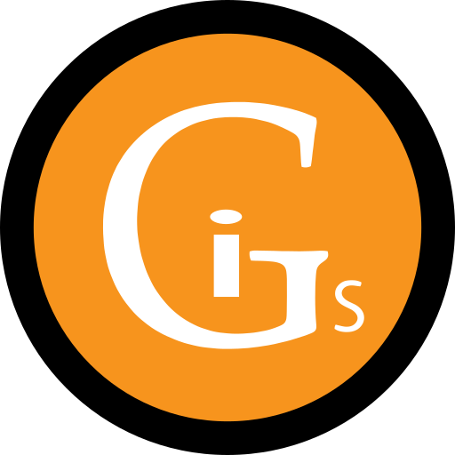

<div align="center">

<h1>
  
  iGroup Solutions — Website Redesign
</h1>

<p><strong>We Build Your Digital Future.</strong><br />
A modern, motion-led redesign of the iGroup Solutions website — a Sri Lankan software development company delivering since 2015.</p>

<p>
  
  
  
  
  
  
</p>

<a href="https://i-group-solutions-redesign-gw9u.vercel.app/">
  
</a>

</div>

---

## 📖 About the project

This repository is a ground-up rebuild of [igroupsolutions.lk](https://www.igroupsolutions.lk) as a single-page React application. Every piece of content from the original site — services, about, clients, careers and contact details — is preserved, while the design, motion and interaction are rebuilt around the iGS brand orange.

The site ships with a dark ember theme by default and a warm cream light theme, both driven by the same design tokens.

**Page sections:** Hero · Stats · Services · About · Clients · Careers · Contact · Footer

## 🔄 Original vs. redesign

| | Original site | Redesign |
|---|---|---|
| **Stack** | Bootstrap, jQuery, MDB, Slick carousel | React 19, Vite 6 |
| **Look** | Light theme with stock photography | Dark ember theme plus a warm cream light theme |
| **Motion** | Static sections | GSAP timelines, ScrollTrigger and Lenis smooth scroll |
| **Hero** | Photo banner with a headline | Liquid-metal `iGROUP` wordmark inside a breathing ember ring |
| **Clients** | Slick logo carousel | Marquee with a silhouette-to-colour hover reveal |
| **Logo** | 200×90 PNG | Vector SVG set, round badge favicon and 2400px PNG exports |
| **Content** | — | All original copy, roles and contact details carried over |

## ✨ Features

### 🎨 Design and motion

- **Hero intro** — the ember ring, wordmark, headline and navigation play in as a single GSAP timeline as soon as the display font is ready, with no loading screen.
- **Liquid-metal wordmark** — the hero `iGROUP` is rendered with React Bits **MetallicPaint** (WebGL2): warm gold on the dark theme, copper on the light theme.
- **Ember ring** — a slow-breathing halo with a highlight that glides around it, rotated on the GPU so it stays cheap to render.
- **Scroll reveals** — sections reveal as they enter the viewport and replay when scrolled back into view.
- **Drifting light pools** — soft radial glows float behind the page with gentle parallax.
- **Self-fitting footer** — the giant `iGROUP` wordmark measures itself to span the container exactly at any width.

### 🖱️ Interaction

- **Dark and light themes** — a sun/moon toggle in the navigation switches themes, with the new theme spreading out from the toggle as a soft radial reveal. The choice is saved and applied before first paint, so returning visitors see no flash.
- **Smooth scrolling** — Lenis drives the scroll, synced to GSAP's ticker so every ScrollTrigger stays in step.
- **Services list** — numbered rows with an orange fill that slides in from whichever edge the cursor crosses.
- **Scroll-proof hover** — service rows, career roles and footer links are hit-tested every frame, so they respond even while content glides under a resting cursor.
- **Touch-friendly** — on touch screens, the row crossing the middle of the screen takes the hover look instead.
- **Client marquee** — logos rest as silhouettes and reveal their true colours on a light tile when hovered.
- **Custom cursor** — a precise dot with a trailing ring that grows over links, for mouse and trackpad users only.
- **Sliding social dock** — a highlight tile glides beneath the hovered icon.

### ♿ Accessibility and quality

- Semantic headings with screen-reader text for the visual-only wordmark
- Visible keyboard focus styles
- `prefers-reduced-motion` support across the intro, reveals, scrolling and theme switch
- Responsive layout from desktop down to phone widths
- Google Analytics tag carried over from the original site

## 🛠️ Tech stack

| Layer | Tools |
|---|---|
| Framework | [React 19](https://react.dev), [Vite 6](https://vite.dev) |
| Animation | [GSAP 3.15](https://gsap.com) (ScrollTrigger, SplitText), `@gsap/react`, View Transitions API |
| Scrolling | [Lenis](https://lenis.darkroom.engineering) |
| Components | [React Bits](https://reactbits.dev) — MetallicPaint, SplitText, ScrollReveal, ScrollFloat, LogoLoop, CountUp, ShinyText, StarBorder |
| Typography | Unbounded (display), Space Grotesk (body), Oswald (condensed) — via Google Fonts |
| Tooling | `@resvg/resvg-js` for logo PNG exports; Python scripts for rebuilding the logo vectors |

## 🚀 Getting started

### 📋 Prerequisites

- [Node.js](https://nodejs.org) 18 or later
- npm

### 📦 Installation

```bash
git clone https://github.com/Mihiran-Thilakarathna/iGROUP-Solutions_Redesign.git
cd iGROUP-Solutions_Redesign
npm install
npm run dev
```

The development server runs at <http://localhost:5173>.

### ⚙️ Available scripts

| Command | Description |
|---|---|
| `npm run dev` | Start the development server with hot module replacement |
| `npm run build` | Create an optimised production build in `dist/` |
| `npm run preview` | Serve the production build locally |
| `npm run logo:png` | Export every SVG in `brand/` as high-resolution PNGs |

## 🗂️ Project structure

```text
.
├── _source_assets/            Original files from the current live site (reference only)
├── brand/                     Vector logo set and high-resolution PNG exports
├── public/                    Static files: favicons, logos, client logos
├── scripts/
│   ├── build_logo.py          Rebuilds the logo SVGs from typefaces
│   ├── build_badge.py         Rebuilds the round badge and favicon from artwork
│   └── export-logo.mjs        Renders SVG → PNG with resvg
├── src/
│   ├── components/
│   │   ├── reactbits/         React Bits components
│   │   ├── Navbar.jsx         Navigation, active-section pill, mobile menu
│   │   ├── ThemeToggle.jsx    Animated sun/moon theme switch
│   │   ├── Cursor.jsx         Custom desktop cursor
│   │   ├── PageGlows.jsx      Drifting background light pools
│   │   ├── Hero.jsx           Metallic wordmark, ember ring, intro timeline
│   │   ├── Stats.jsx          Animated counters
│   │   ├── Services.jsx       "What we build for you" rows
│   │   ├── About.jsx          Lead statement, founding year, call to action
│   │   ├── Clients.jsx        Logo marquee and closing statement
│   │   ├── Careers.jsx        Open roles
│   │   ├── Contact.jsx        Contact form and details card
│   │   ├── SocialDock.jsx     Social links with sliding highlight
│   │   └── Footer.jsx         Call to action, link columns, fitted wordmark
│   ├── data/content.js        All site copy in one place
│   ├── gsap.js                GSAP and Lenis setup, shared reveal helpers
│   ├── theme.js               Theme state and the radial reveal transition
│   ├── rowHover.js            Hover detection that keeps up with smooth scrolling
│   └── index.css              Design tokens (dark and light) and global styles
├── index.html
├── package.json
└── vite.config.js
```

## 🎛️ Customisation

| What | Where |
|---|---|
| Copy, services, clients, roles, contact details, social links | [`src/data/content.js`](src/data/content.js) |
| Colours, fonts and spacing for both themes | Design tokens at the top of [`src/index.css`](src/index.css) |
| Contact form destination | `formAction` in [`src/data/content.js`](src/data/content.js) — currently the original site's mail handler |
| Default theme | The inline script in [`index.html`](index.html) — dark unless the visitor has chosen light |

## 🏷️ Brand assets

The original logo was a 200×90 PNG. The `brand/` folder holds a vector rebuild that stays sharp at any size.

| File | Use |
|---|---|
| `logo-light.svg` | Original colours, for light backgrounds (light theme) |
| `logo-dark.svg` | White wordmark, for dark backgrounds (dark theme) |
| `logo-badge.svg` | Round iGS badge; the favicon is this badge without its outer ring |
| `icon.svg` | Square mark for avatars |
| `*-2400w.png`, `*-512w.png` | High-resolution PNG exports |

**Brand orange:** `#F79420`

<details>
<summary>Regenerating the logo files</summary>

```bash
# Logo SVGs from typefaces — needs Python with fontTools; reads fonts from C:/Windows/Fonts
python scripts/build_logo.py brand

# Round badge and favicon from artwork — needs Python with opencv-python and numpy
python scripts/build_badge.py _source_assets/logo-igs-badge.png brand/logo-badge.svg
python scripts/build_badge.py _source_assets/logo-igs-badge.png public/favicon.svg --no-rim

# PNG exports of everything in brand/
npm run logo:png
```

</details>

## 🌐 Browser support

Built for current versions of Chrome, Edge, Firefox and Safari. Two features degrade gracefully:

- **WebGL2 unavailable** — the hero shows the `iGROUP` wordmark as plain type instead of liquid metal.
- **View Transitions unavailable** — the theme switch cross-fades the colours instead of the radial reveal.

## 🙏 Acknowledgements

- [React Bits](https://reactbits.dev) for the interactive components
- [GSAP](https://gsap.com) for animation and [Lenis](https://lenis.darkroom.engineering) for smooth scrolling
- [Google Fonts](https://fonts.google.com) for Unbounded, Space Grotesk and Oswald
- Client logos belong to their respective owners

---

<div align="center">

Redesigned by **[Mihiran Thilakarathna](https://github.com/Mihiran-Thilakarathna)**

© iGroup Solutions · Software Development in Sri Lanka · All rights reserved.

</div>
