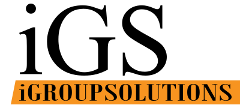

<div align="center">

<picture>
  <source media="(prefers-color-scheme: dark)" srcset="brand/logo-dark.svg" />
  
</picture>

# iGroup Solutions — Website Redesign

**We Build Your Digital Future.**
A modern, motion-led redesign of the iGroup Solutions website — a software development company delivering since 2015.

<p>
  
  
  
  
  
</p>

<a href="https://i-group-solutions-redesign-gw9u.vercel.app/">
  
</a>

</div>

---

## ✦ Overview

A dark, ember-toned single-page site built around the iGS brand orange. Every section from the original website is carried over — services, about, clients, careers and contact — and rebuilt with cinematic GSAP motion, buttery Lenis scrolling and interactive components from [React Bits](https://reactbits.dev).

## ✦ The original website

This project redesigns the existing site at **[igroupsolutions.lk](https://www.igroupsolutions.lk)**. All of its content is preserved; the experience around it is rebuilt.

| | Original site | Redesign |
|---|---|---|
| **Stack** | Bootstrap, jQuery, MDB, Slick carousel | React 19, Vite 6 |
| **Look** | Light theme with stock photography | Dark ember theme in the brand orange |
| **Motion** | Static sections | GSAP timelines, ScrollTrigger, Lenis smooth scroll |
| **Hero** | Photo banner with headline | Liquid-metal `iGROUP` wordmark inside a breathing ember ring |
| **Clients** | Slick logo carousel | Marquee with silhouette-to-colour hover reveal |
| **Logo** | 200×90 PNG | Vector SVG set + 2400px PNG exports |
| **Content** | — | All original copy, roles and contact details carried over |

## ✦ Highlights

| | |
|---|---|
| **Minimal preloader** | The iGS logo assembles itself — wordmark rises, orange band sweeps in — over a thin progress line, then wipes up into the hero. |
| **Liquid-metal wordmark** | The hero `iGROUP` is rendered with React Bits **MetallicPaint** (WebGL2). Falls back to plain type where WebGL2 is unavailable. |
| **Smooth scrolling** | Lenis drives the scroll, synced to GSAP's ticker so every ScrollTrigger stays frame-perfect. |
| **Drifting light pools** | Soft radial glows float behind the page with gentle parallax. |
| **Client marquee** | Logos rest as silhouettes and reveal their true colours on a light tile when hovered. |
| **Sliding social dock** | A highlight tile glides beneath the hovered icon. |
| **Self-fitting footer** | The giant `iGROUP` wordmark measures itself to span the container exactly at any width. |
| **Accessible by default** | Semantic headings, keyboard focus styles, `prefers-reduced-motion` support and a responsive layout from desktop down to phone widths. |

## ✦ Tech stack

| Layer | Tools |
|---|---|
| Framework | React 19, Vite 6 |
| Motion | GSAP 3.13 (ScrollTrigger, SplitText), `@gsap/react` |
| Scrolling | Lenis |
| Components | React Bits — MetallicPaint, SplitText, ScrollReveal, ScrollFloat, LogoLoop, CountUp, ShinyText, StarBorder |
| Typography | Unbounded (display), Space Grotesk (body), Oswald (condensed) |

## ✦ Getting started

**Requirements:** Node.js 18+ and npm.

```bash
git clone https://github.com/Mihiran-Thilakarathna/iGROUP-Solutions_Redesign-.git
cd iGROUP-Solutions_Redesign-
npm install
npm run dev
```

Open <http://localhost:5173>.

| Script | What it does |
|---|---|
| `npm run dev` | Start the dev server with hot reload |
| `npm run build` | Build the production site into `dist/` |
| `npm run preview` | Serve the production build locally |
| `npm run logo:png` | Re-export the brand SVGs as high-resolution PNGs |

## ✦ Project structure

```
├── _source_assets/         Original files from the current live site (reference)
├── brand/                  Vector logo set + high-res PNG exports
├── public/                 Static files (favicon, logos, client logos)
├── scripts/
│   ├── build_logo.py       Rebuilds the logo SVGs from typefaces
│   └── export-logo.mjs     Renders SVG → PNG (resvg)
└── src/
    ├── components/
    │   ├── reactbits/      React Bits components
    │   ├── Preloader.jsx   Loading screen
    │   ├── Hero.jsx        Metallic wordmark, ember ring, intro timeline
    │   ├── Services.jsx    "What we build for you" rows
    │   ├── Clients.jsx     Logo marquee + statement
    │   ├── Careers.jsx     Open roles
    │   ├── Contact.jsx     Form + contact card
    │   └── Footer.jsx      CTA, link columns, fitted wordmark
    ├── data/content.js     All site copy in one place
    ├── gsap.js             GSAP + Lenis setup, intro hand-off
    └── index.css           Design tokens and global styles
```

## ✦ Editing content

All copy — services, clients, careers, contact details and social links — lives in [`src/data/content.js`](src/data/content.js). Update it there and every section follows. The contact form posts to the original site's mail handler, set by `formAction` in the same file.

## ✦ Brand

The original logo was a 200×90 PNG. `brand/` contains a vector rebuild that stays sharp at any size:

| File | Use |
|---|---|
| `logo-light.svg` | Original colours — light backgrounds |
| `logo-dark.svg` | White wordmark — dark backgrounds (used on the site) |
| `icon.svg` | Square mark for favicons and avatars |
| `*-2400w.png`, `*-512w.png` | High-resolution PNG exports |

Brand orange: **`#F79420`**

## ✦ Credits

- Components from [React Bits](https://reactbits.dev)
- Animation by [GSAP](https://gsap.com) · smooth scroll by [Lenis](https://lenis.darkroom.engineering)
- Fonts from [Google Fonts](https://fonts.google.com)

---

<div align="center">

© iGroup Solutions · Software Development in Sri Lanka · All rights reserved.

</div>
